<!-- ========================================================= -->
<!--                          HERO                             -->
<!-- ========================================================= -->

  <a href="https://github.com/Adil-Ahmed-1">
    
  </a>


<!-- ========================================================= -->
<!--                        INTRO                              -->
<!-- ========================================================= -->

<table align="center" width="96%">
<tr>
<td valign="top">

<h2>Building full-stack apps &amp; AI systems</h2>

I'm a <strong>Full-Stack Developer from Pakistan</strong> who builds complete
web platforms — from PHP/MySQL backends and AJAX-driven interfaces to
YOLOv8-powered computer-vision systems.

From <strong>role-based blog management systems</strong> and
<strong>real-time group chat apps</strong> to an
<strong>AI crowd-anomaly detector</strong> that cut false positives by 25%,
I focus on clean code, secure auth, and shipping things people actually use.

<table>
<tr>
<td><strong>Frontend</strong> HTML5 · CSS3 · JavaScript · Bootstrap · React</td>
<td><strong>Backend</strong> PHP · MySQL · AJAX · REST APIs</td>
</tr>
<tr>
<td><strong>AI / CV</strong> Python · YOLOv8 · OpenCV · Custom datasets</td>
<td><strong>CMS</strong> WordPress · Elementor · SEO · Theme customization</td>
</tr>
</table>

<a href="https://www.linkedin.com/in/adil-khoso/"><strong>LinkedIn</strong></a> ·
<a href="https://github.com/Adil-Ahmed-1"><strong>GitHub</strong></a> 
Building in public at <a href="https://github.com/Adil-Ahmed-1?tab=repositories">github.com/Adil-Ahmed-1</a> 
<em>Fun fact: I debug faster with console.log than with a debugger.</em>

</td>
</tr>
</table>


  

 


<!-- ========================================================= -->
<!--                   TECHNOLOGY MATRIX                       -->
<!-- ========================================================= -->

  


<!-- ========================================================= -->
<!--                      WHAT I BUILD                         -->
<!-- ========================================================= -->

  


<!-- ========================================================= -->
<!--                     FEATURED WORK                         -->
<!-- ========================================================= -->

<h2 align="center">Featured Work</h2>

<table align="center" width="96%">
<tr>
<td width="50%" valign="top">
<h3>Crowd Anomaly Detection System</h3>
Python · YOLOv8 · OpenCV

AI surveillance that detects unusual activity in crowded scenes — real-time video, custom datasets, and 25% fewer false positives.

</td>
<td width="50%" valign="top">
<h3>Blog Management System</h3>
PHP · MySQL · Bootstrap · JavaScript

Full blogging platform with role-based access (Admin / Editor / User), category management, pagination, and secure login.

</td>
</tr>
<tr>
<td width="50%" valign="top">
<h3>Group Chat Application</h3>
PHP · MySQL · AJAX · JavaScript

Real-time group chat with online-status tracking, AJAX messaging (no page reloads), and persistent chat history.

</td>
<td width="50%" valign="top">
<h3>Online Blogging Application</h3>
PHP · MySQL · Bootstrap · AJAX

Blogging platform with login/register, email inbox, live chat, live search, dependent dropdowns, and dynamic content.

</td>
</tr>
<tr>
<td width="50%" valign="top">
<h3>WordPress Business Websites</h3>
WordPress · Elementor · PHP

Multiple responsive client sites — plugin integration, SEO tuning, theme/widget customization, performance work.

</td>
<td width="50%" valign="top">
<h3>Portfolio Website</h3>
React.js · HTML5 · CSS3 · JavaScript

Modern React portfolio showcasing projects, skills, and contact info — optimized across devices.

</td>
</tr>
</table>

<a href="https://github.com/Adil-Ahmed-1?tab=repositories"><b>Explore all projects →</b></a>


<!-- ========================================================= -->
<!--                      OBSERVABILITY                        -->
<!-- ========================================================= -->

<h2 align="center">Activity</h2>

  
  

  

  


<!-- ========================================================= -->
<!--                        DEV PETS                           -->
<!-- ========================================================= -->

  


<!-- ========================================================= -->
<!--                        CONNECT                            -->
<!-- ========================================================= -->

  <a href="https://github.com/Adil-Ahmed-1">
    
  </a>

  
  

